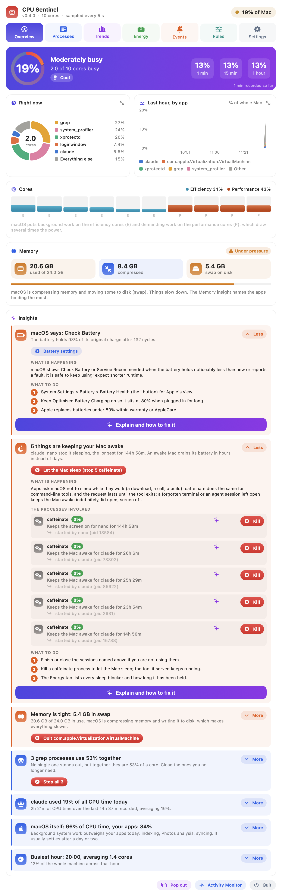
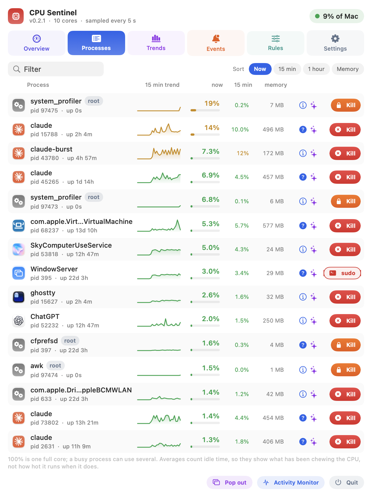
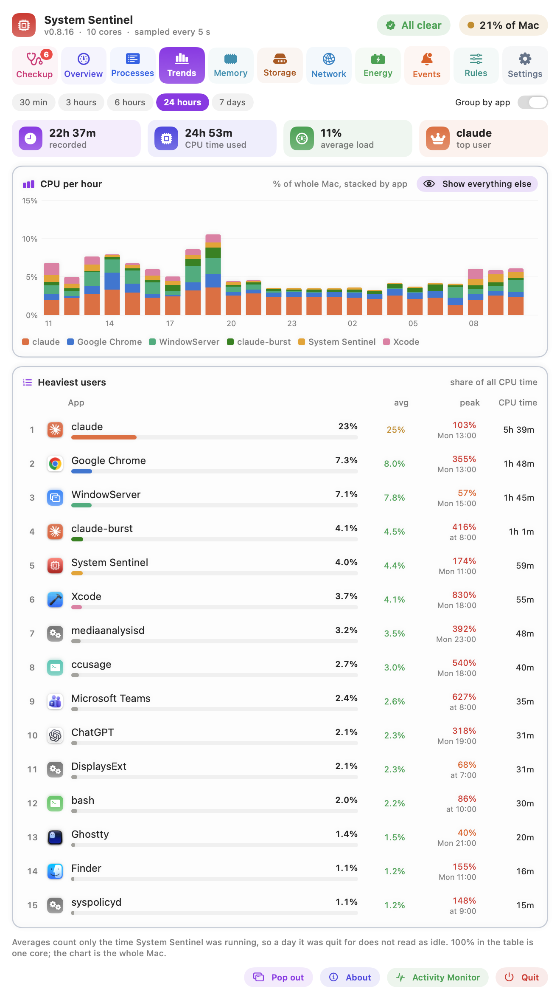
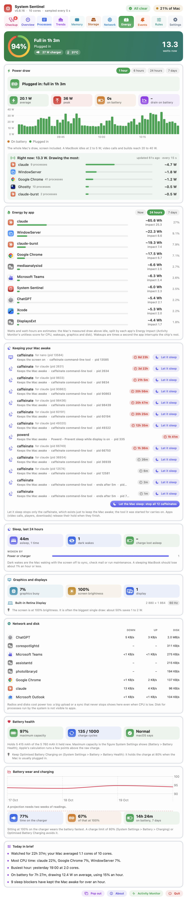
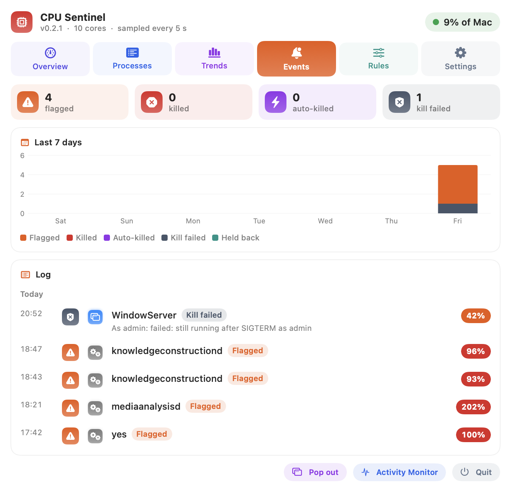
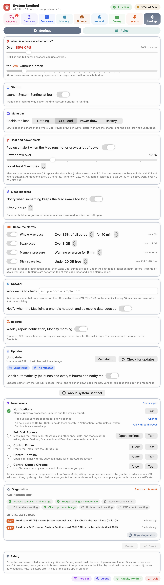
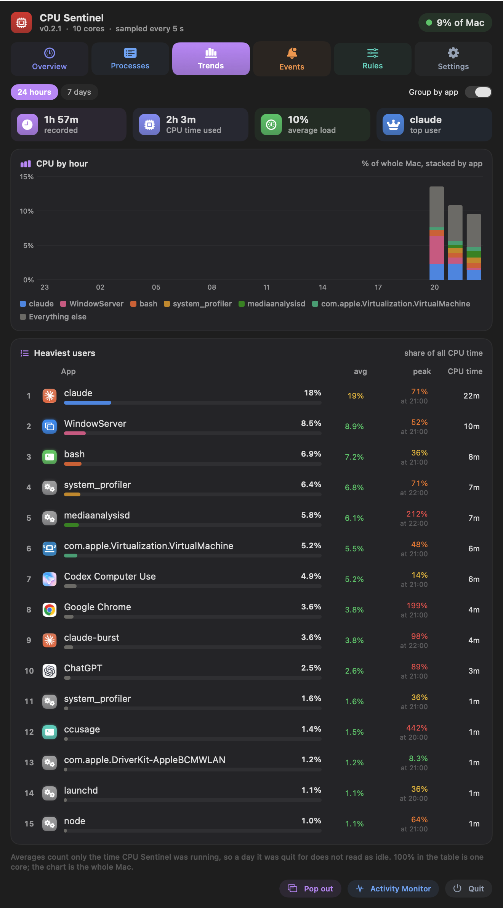

# CPU Sentinel

**Find out what is using your Mac's CPU and battery, why, and what to do about it.**

CPU Sentinel lives in the menu bar. It samples every process every 5 seconds and shows the
load on a gauge, as charts and as plain-English insights. It records which apps used the
most CPU over the last day and week, and explains what each macOS process is for. The
Energy tab shows the Mac's power draw, which apps cost the most battery, what keeps the Mac
awake and how the battery is wearing. When
something gets stuck at high CPU it tells you, and it can kill that process in one click or
automatically.



## Install

Paste this into Terminal. It downloads the latest release, installs it to Applications,
clears the quarantine flag (the app is not notarised by Apple) and launches it:

```bash
cat > ~/install-cpu-sentinel.sh <<'EOF'
#!/bin/bash
# Installs (or updates to) the latest CPU Sentinel release in /Applications.
set -euo pipefail
REPO="andrewbakercloudscale/cpu-sentinel"
APP="${CPU_SENTINEL_APP:-/Applications/CPU Sentinel.app}"
TMP="$(mktemp -d)"
trap 'rm -rf "$TMP"' EXIT

echo "== Downloading the latest release"
if command -v gh >/dev/null 2>&1 && gh auth status >/dev/null 2>&1; then
  gh release download --repo "$REPO" --pattern 'CPU-Sentinel-*.zip' --dir "$TMP"
else
  URL="$(curl -fsSL "https://api.github.com/repos/$REPO/releases/latest" \
    | grep -o '"browser_download_url": *"[^"]*\.zip"' | head -1 | cut -d'"' -f4 || true)"
  if [ -z "$URL" ]; then
    echo "Could not reach the release. If the repository is private, install GitHub CLI"
    echo "(brew install gh), run: gh auth login, then run this script again."
    exit 1
  fi
  curl -fL --progress-bar -o "$TMP/CPU-Sentinel.zip" "$URL"
fi
ZIP="$(ls "$TMP"/*.zip | head -1)"

echo "== Installing to $APP"
pkill -x CPUSentinel 2>/dev/null || true
ditto -x -k "$ZIP" "$TMP/unzipped"
rm -rf "$APP"
ditto "$TMP/unzipped/CPU Sentinel.app" "$APP"
xattr -cr "$APP"

if [ -z "${CPU_SENTINEL_NO_OPEN:-}" ]; then
  echo "== Launching"
  open "$APP"
fi
echo "Done: $(defaults read "$APP/Contents/Info" CFBundleShortVersionString). Look for the red chip in the menu bar."
EOF
chmod +x ~/install-cpu-sentinel.sh && ~/install-cpu-sentinel.sh
```

Run `~/install-cpu-sentinel.sh` again any time to update. You need macOS 14 or later.
Look for the red chip  in the menu bar.

**Build from source instead** (needs Xcode or its command line tools, `xcode-select --install`):

```bash
git clone https://github.com/andrewbakercloudscale/cpu-sentinel.git
cd cpu-sentinel
bash scripts/build-app.sh      # runs the tests, builds, installs to ~/Applications, launches
```

## Why

On a Mac that feels slow, Activity Monitor gives you a list of numbers. It doesn't tell you:

- **which processes are a problem** rather than a passing spike;
- **what a process is,** like `mediaanalysisd`, `knowledgeconstructiond` or `WindowServer`;
- **whether it's safe to kill** a process;
- **which app used the most CPU** over the last day or week;
- **what is draining the battery,** or keeping the Mac awake with the lid open.

CPU Sentinel answers each of those. It was built after a macOS energy logger
(`PerfPowerServices`) used one and a half cores for 37 hours and nothing said so.

## Highlights

| | |
|---|---|
| **Insights in plain English** | "WindowServer is busy because the screen is being captured", "Photos is analysing your library", "3 Chrome tab processes use 40% together". Click **More** to see what is happening, each process involved and who started it, and numbered steps to fix it. |
| **One-click fixes** | Insights carry buttons that act, not just advise: **Quit Slack**, **Let the Mac sleep (stop 5 caffeinate)**, **Turn on Low Power Mode**, or the exact System Settings page. A minute after you quit or kill something it tells you what changed: "power 14 W → 6 W, about 4 hours more battery". |
| **Heat and power alerts** | A pop-up when the Mac runs hot or draws more than your chosen watts (default 25 W) for your chosen minutes (default 3), naming the likely culprit with Kill and Ignore buttons. |
| **Explain with ChatGPT** | The sparkles button opens ChatGPT with a ready-made prompt: the process, its CPU history, your Mac model and its busiest processes, asking what it is and how to bring it down. |
| **Battery and energy** | Live power draw in watts and a 7 day chart, time left, energy use and idle wakeups by app with an estimate of the minutes each costs per hour on battery, sleep blockers (including `caffeinate` "on behalf of" a terminal tool) with a Kill button, and battery health: capacity, cycles and macOS's own verdict. |
| **Beyond the CPU** | Memory pressure and swap, graphics load, screen brightness and displays, network and disk by app, how the Mac sleeps (dark wakes and their causes, charge lost with the lid shut), battery wear over time with a projected date for 80%, and charging habits. Chrome's tabs ranked by likely energy use, with Show and Close. |
| **Performance and efficiency cores** | Per-core load on the Overview, split into the efficiency cores macOS uses for background work and the performance cores that draw most of the power. |
| **Reports** | "Today in brief" in plain sentences, comparison with your usual week, apps working far above their own usual, and a weekly report on the Events tab with an optional Monday notification. Export it as Markdown or PDF. |
| **History from 30 minutes to a week** | CPU by app over the last 30 minutes, 3, 6 or 24 hours, or 7 days, the heaviest users and when each one peaked. Kept across restarts and sleep. |
| **Know when a process started** | Every process shows its uptime, so a renderer that has been busy for 13 days is easy to spot. |
| **Kill anything, carefully** | One-click kill for your own processes, your password for root ones, a separate sudo button with a warning for core macOS processes, and Force kill (kill -9) for anything that ignores a kill. A banner says whether it worked and who relaunched it if it came back. |
| **Rules that remember** | Per app: alert (the default), ignore, ignore during work hours or overnight, auto-kill, auto-kill on battery, or auto-kill only under 30% battery. Auto-kill is limited to 3 kills an hour per app. The Rules tab also lists every launch agent and daemon that starts by itself, with its CPU. |
| **Dark mode, and a window you can move** | Every screen is designed for light and dark. **Pop out** moves the panel into a normal window you can drag. The menu bar can show CPU load, watts or battery beside the icon. |

## Screenshots

### Processes
The top 30, each with uptime, a 15 minute trend, averages, memory and Kill.



### Trends
CPU by hour, stacked by app, and the heaviest users over 24 hours or 7 days.



### Energy

Power draw, energy by app, what keeps the Mac awake, and battery health.



### Events
Everything flagged, killed or auto-killed over 7 days.



### Settings
What counts as a stuck process, and launch at login.



### Dark mode
Every screen has its own dark design.



## Documentation

- **[User guide](docs/guide.md):** every screen, reading the charts, insights, killing
  processes, rules, notifications, privacy and troubleshooting.
- **[Process guide](docs/processes.md):** what the common macOS background processes are,
  why they get busy, and whether to kill them.
- **[PLAN.md](PLAN.md):** design and reasoning.

## Safety, in short

- Core macOS processes (WindowServer, kernel_task, launchd, Finder, Dock and others) are never
  killed automatically and have no Kill button. Their **sudo kill** button warns you what will
  happen first.
- Root processes need your admin password and are never auto-killed.
- Auto-kill applies only to apps you opted in, at most 3 times an hour each.

## Privacy

Everything stays on your Mac. CPU Sentinel sends nothing anywhere. The only time data
leaves is when you click **Explain**. That opens ChatGPT in your browser with a prompt
describing the process and your Mac. [What's in it](docs/guide.md#explain-with-chatgpt).

## Development

```bash
swift test                     # 91 tests, including a real CPU burner that must be flagged and killed
swift build                    # debug build
bash scripts/build-app.sh      # test, build, bundle, install, launch
bash scripts/release.sh        # zip for a GitHub release in dist/; signs and notarises
                               # when DEVELOPER_ID and NOTARY_PROFILE are set
```

To render every tab, in light and dark, to PNG files without touching your data:

```bash
"build/CPU Sentinel.app/Contents/MacOS/CPUSentinel" --snapshot /tmp/shots --after 600 --expand 2
```

`--after` sets how many seconds to sample before rendering (default 22). `--expand` opens
only the first n insights (default all). The README screenshots are made this way.

The code is split into `SentinelCore` (sampling, detection, history, insights; tested) and
`CPUSentinel` (the SwiftUI app).
