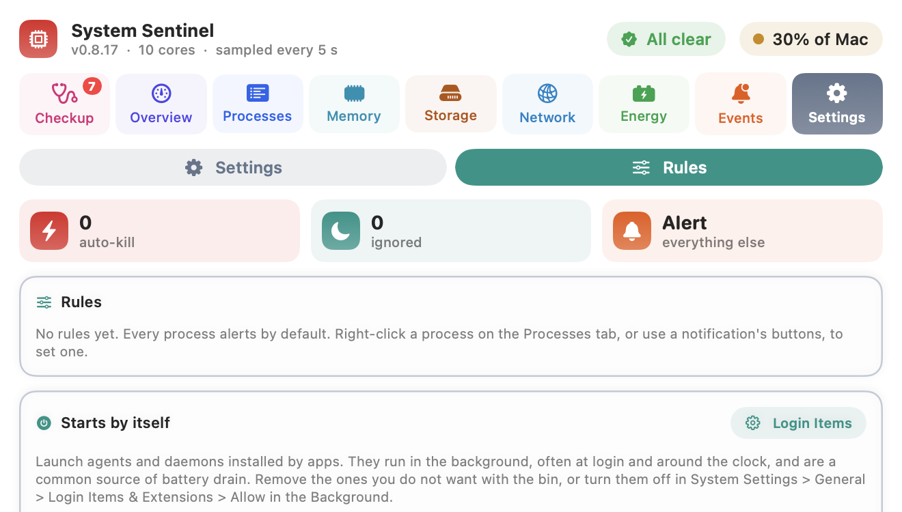

# CPU Sentinel user guide

[Back to README](../README.md) · [Process guide](processes.md)

- [The basics: what the percentages mean](#the-basics-what-the-percentages-mean)
- [The menu bar icon](#the-menu-bar-icon)
- [Overview](#overview)
- [Insights](#insights)
- [Processes](#processes)
- [Trends](#trends)
- [Events](#events)
- [Rules](#rules)
- [Settings](#settings)
- [Notifications](#notifications)
- [Killing processes](#killing-processes)
- [Explain with ChatGPT](#explain-with-chatgpt)
- [Pop out window](#pop-out-window)
- [Files and privacy](#files-and-privacy)
- [Troubleshooting](#troubleshooting)

---

## The basics: what the percentages mean

macOS counts CPU per core, and CPU Sentinel uses two scales:

| Where | Scale | Example on a 10-core Mac |
|---|---|---|
| Process lists, Trends table, notifications | **100% = one core**, like Activity Monitor | a process at 250% is using two and a half cores |
| Gauge, charts, "% of Mac" pill | **100% = every core** | 25% means two and a half of the ten cores are busy |

So a single process can show more than 100%, and the whole Mac is busy only when the gauge
approaches 100%.

**Averages** cover the time CPU Sentinel was running. If it was quit or the Mac was asleep,
those hours count as unknown, not idle, so an evening with the Mac closed doesn't pull the
average down.

**Sampling.** CPU Sentinel reads the process table every 5 seconds with `ps`, the same
source Activity Monitor uses. CPU Sentinel itself uses well under 1% of one core.

---

## The menu bar icon

| Icon | Meaning |
|---|---|
|  | Running. Click to open the panel. |
|  | A process has stayed over your threshold and was flagged. Check Events or the notification. |

The pill in the top right shows the whole Mac's load right now. Its dot turns from green
to amber to red as the load rises.

---

## Overview

The answer to "is my Mac busy, and why?" in one screen:

- **Gauge and headline.** The whole Mac's load, how many cores are busy and a thermal chip:
  Cool, Warm, Hot, throttling, or Overheating. When the Mac is hot, macOS slows the CPU down, so the same
  work takes more of it.
- **1 min / 15 min / 1 hour.** Load averaged over each period. A high 1 minute figure with
  a low 1 hour figure is a spike; all three high means it has been busy for a while.
- **Right now.** A donut of the five apps using the most CPU at this moment, plus
  everything else. The number in the middle is cores in use.
- **Last hour, by app.** A stacked chart of the top apps over the last hour, as a share of
  the whole Mac. Colours stay with each app across every chart in the app, so Chrome is
  always the same colour.
- **Click either chart** to open a larger, live version in its own window. The larger
  Right now chart lists more apps with cores used; the larger Last hour chart shows the
  values at any moment when you hover over it.
- **Insights.** See below.

---

## Insights

Insights are short findings worked out from what CPU Sentinel has seen. The most urgent
ones come first. Each has a coloured edge: red is urgent, amber is worth a look, blue is
for your information and green means all is well.

Click **More** on an insight to open it:

- **What is happening:** the longer explanation.
- **The processes involved:** each one with its CPU, what it is, and **started by**: the
  app that launched it. That is how you find which app keeps taking screenshots, for
  example. Each process has its own Explain, bring-to-front and Kill buttons.
- **What to do:** numbered steps.
- **Explain and how to fix it:** opens ChatGPT with the whole insight as a prompt.

### Insights you may see

| Insight | When it appears | What it tells you |
|---|---|---|
| **Overheating / hot / running warm** | macOS reports a raised thermal state | macOS is slowing the CPU to cool down. Close the heaviest apps and give the Mac airflow. |
| **Low Power Mode is on** | Low Power Mode is enabled | The CPU runs slower, so everything reads higher. |
| **N% of all cores are busy** | 70% or more of the whole Mac is busy | The Mac is close to flat out. |
| **Busier than usual** | Load is at least twice the last hour's average | Something new has started. |
| **All quiet** | Under 10% of the Mac is in use | Nothing needs attention. |
| **X has averaged N% for 15 minutes** | A process has stayed at 50% or more for the last 15 minutes | Sustained use, not a spike: a candidate for a rule. |
| **X (N%): what it is** | A macOS service you may not recognise is at 20% or more | What it does and whether to wait or act. See the [process guide](processes.md). |
| **WindowServer is busy because the screen is being captured** | WindowServer is at 20% or more while a capture service is active | Every screenshot, recording, screen share or AI agent screenshot makes WindowServer draw a full frame. The capture services are listed one by one. |
| **WindowServer is at N%** | WindowServer is busy with no capture running | Usually displays: scaled resolutions, 120 Hz, many windows, transparency. |
| **N copies of X use N% together** | Three or more processes of one app add up to 15% or more | Easy to miss in a list, such as Chrome tabs or idle terminal sessions. |
| **X used N% of all CPU time today** | After 30 minutes of recording | The day's heaviest app. |
| **macOS itself vs your apps** | After 30 minutes of recording | How much CPU went to background system work compared with apps you run. |
| **Busiest hour** | After an hour of recording | When in the day the Mac worked hardest. |
| **X was flagged N times this week** | An app was flagged three or more times in 7 days | Set a rule instead of dismissing the alert again. |
| **X survived a kill** | A kill failed in the last 24 hours | The process ignored the polite stop signal; only a force kill would stop it. |

### Example: WindowServer and screen capture

WindowServer draws everything on your displays. Normally it redraws only what changed,
which is cheap. A screen capture makes it produce a whole new frame at full Retina
resolution every time, even when nothing moved. Something that captures several times a
second keeps WindowServer busy all the time:

- **SkyComputerUseService, Codex Computer Use:** AI agents that screenshot your screen so
  the AI can see it. They can keep capturing while idle.
- **replayd:** macOS screen recording. Busy while any app records, streams or shares the screen.
- **screencapture:** the screenshot command. If it keeps coming back, check **started by**
  to see which app runs it in a loop.
- **screencaptureui:** the screenshot toolbar and recording overlay (Cmd-Shift-5).

To fix it: stop the agent, recording or screen share. Then review **System Settings >
Privacy & Security > Screen & System Audio Recording** and switch off apps that shouldn't
be capturing.

---

## Processes

The 30 busiest processes, refreshed every 5 seconds.

- **Filter** by name. **Sort** by CPU now, the 15 minute, 1 hour or 6 hour average, or
  memory. Sorting by an average ranks every process, including ones idle right now, and the
  average column switches to that window.
- **pid and uptime:** "up 13d 0h" means the process has been running for 13 days. A busy
  process with a long uptime is a classic stuck process.
- **Badges:** `root` (runs as the system, needs your password to kill), `hot 1m 20s` (over
  your threshold for that long), `flagged`, and its rule if it has one (`auto-kill`,
  `ignored`).
- **15 min trend:** a sparkline of its CPU.
- **now / 15 min / memory:** the CPU now with a heat bar, the 15 minute average and memory used.
- **ⓘ** opens a popover with its averages, a 1 hour chart and its full path. A filled **?**
  instead means the [process guide](processes.md) knows it, and the popover also says what
  it is and gives a verdict: *Normal: it settles on its own*, *Safe to stop*, *Do not kill*
  or *Something you started*.
- **✨ Explain** opens ChatGPT about this process.
- **Kill** (red) quits it. **Kill** with a lock (orange) is a root process and asks for your
  password. **sudo kill** (outlined) is a core macOS process; see [Killing processes](#killing-processes).
  While a kill runs the button reads **Killing…**, and a banner over the page then says
  whether it worked.
- **restarted** means the process was killed a moment ago and launched again under this pid.

**Right-click** a row for more:

- **Rule:** Alert me (the default), Auto-kill, Ignore for 1 hour, Always ignore.
- **For apps:** Bring to front, Quit gracefully (asks the app to quit, so it can save your work).
- Reveal in Finder, Copy pid, Copy sudo kill command, Open Activity Monitor.

Chrome runs each site in its own process, shown as **Chrome tab (renderer N)**. Chrome
doesn't reveal which tab a renderer serves; use Chrome's own Task Manager (Window > Task
Manager) to match them up.

---

## Trends

What used the CPU over time, kept across restarts.

- **30 min / 3 hours / 6 hours / 24 hours / 7 days.** Bars of 1 minute, 5 minutes,
  10 minutes, 1 hour and 6 hours. Up to 6 hours comes from a one-minute record, longer from
  the hourly one.
- **Group by app.** On: helpers count towards their app, so all Chrome tabs count as
  Chrome. Off: each executable on its own line.
- **Tiles:** how long was recorded, total CPU time used, the average load and the top app.
- **CPU by hour:** stacked bars as a share of the whole Mac. The top six apps have their
  own colours and the rest are grey. Hours with no recording are left blank.
  **Hide everything else** drops the grey bars, so the named apps fill the chart.
- **Heaviest users:** share of all CPU time (the bar), the average over the recorded time,
  the peak hour and when it was, and total CPU time. Hover a row to see what the process is.

**CPU time** is core-time: one core busy for one minute is one minute of CPU time, so an
app can use more CPU time than the time that passed.

---

## Events

Everything CPU Sentinel did, or decided not to do:

| Event | Meaning |
|---|---|
| **Flagged** | The process stayed over your threshold for the whole window. |
| **Killed** | You killed it. |
| **Auto-killed** | A rule killed it. |
| **Kill failed** | It was still running after the kill: it ignored the polite signal, or the password prompt was cancelled. |
| **Held back** | A rule said auto-kill, but it had already been killed 3 times in the last hour, so you were alerted instead. |

The tiles count the last 7 days, the chart shows each day, and the log lists every event
with its time and CPU.

---

## Rules

Every app you have set a rule for, and a button to remove each one. Rules are keyed by the
program's path, so they survive restarts and new process IDs. All Chrome tabs share one
path, so a rule for one tab applies to every tab.

| Rule | What happens when the process is flagged |
|---|---|
| **Alert** (default) | A notification; you decide. |
| **Ignore for 1 hour / always** | Nothing. |
| **Auto-kill** | It is killed and you are told. Not offered for root or core macOS processes. At most 3 kills an hour per app; after that you are alerted instead. |

---

## Settings

- **Over N% CPU for N minutes without a break** decides when a process is flagged. The
  default is 80% (of one core) for 2 minutes. Builds and other short bursts never count;
  only a process that stays over the line the whole time does.
- **Launch CPU Sentinel at login.**

Changes apply when you click **Save**. **Revert** throws them away.

---

## Notifications

When a process is flagged you get a notification with:

- **Kill**: kill it now.
- **Ignore for 1 hour**: no more alerts for it for an hour.
- **Always ignore**: never alert for this app again (removable on the Rules tab).
- **Always auto-kill**: kill it now and every time from now on.

Each process alerts once per episode, not every 5 seconds. If notifications don't appear,
allow them in **System Settings > Notifications > CPU Sentinel**.

---

## Killing processes

| Button | For | What happens |
|---|---|---|
| **Kill** (red) | Your own processes | A polite stop signal (SIGTERM), and a force kill (SIGKILL) 5 seconds later if it is still running. |
| **Kill** with a lock (orange) | Root processes, e.g. PerfPowerServices | macOS asks for your admin password, then sends SIGTERM. Daemons like this are restarted by launchd, usually without the problem. |
| **sudo** (outlined) | Core macOS processes: WindowServer, kernel_task, launchd, loginwindow, Finder, Dock, coreaudiod and others | A warning of what will happen, then four choices: **Open sudo shell** (Terminal with `sudo kill -TERM <pid>` typed in), **Kill with password**, **Copy command**, or **Cancel**. pid 0, pid 1 and CPU Sentinel itself are always refused. |

Things to know:

- **Killing WindowServer logs you out** and closes every app. **kernel_task** is macOS
  cooling the Mac and can't be killed usefully. The [process guide](processes.md) gives a
  verdict for each common process.
- **Force kill.** Some processes ignore the polite signal, and the kill then shows as
  **Kill failed**. The Overview's "survived a kill" insight lists the process with a
  **Force kill** button, and right-clicking any process offers **Force kill (kill -9)…**.
  It confirms first, because the process can't save or clean up. Root and macOS processes
  ask for your password, or you can open a Terminal with `sudo kill -9 <pid>` typed in.
- **Relaunched at once?** Some programs come straight back under a new pid, launched by
  macOS (launchd) or by the app that owns them. The banner says so and names who restarted
  it, and the row shows **restarted**. Killing it again won't help: stop whatever launches it.
- **Terminal kills** (Open sudo shell) are watched for a minute. When the process exits,
  the banner says it stopped.
- **Quit gracefully** (right-click an app) is the gentle option for apps: it asks the app to
  quit, so it can save first.
- Killing a **Chrome tab** renderer shows "Aw, Snap!" in the tabs it served. Reload them to
  bring them back.
- The first time you use the Terminal option, macOS asks whether CPU Sentinel may control
  Terminal. Allow it, or use **Copy sudo kill command** and paste it yourself.

---

## Explain with ChatGPT

Every ✨ button opens `chatgpt.com` in your browser with a prompt filled in. For a process,
the prompt contains:

- the process name, path, whether it runs as root, its CPU now and averaged over 1 minute,
  15 minutes and 1 hour, its memory and when it started;
- what the process guide knows about it;
- your Mac model, number of cores, macOS version, thermal state, displays (resolution and
  refresh rate) and the other busy processes.

An insight's prompt contains the insight, each process involved and who started it, and
the same Mac details. It asks what is going on, the likely causes on your machine, step by
step fixes, and whether killing is safe.

The prompt is part of the page address, so treat it as shared with OpenAI once the page
opens.

---

## Pop out window

The menu bar panel stays pinned under the icon and closes when you click elsewhere. Click
**Pop out** at the bottom to open the same screens in a normal window. You can drag and
minimise it, and it stays open while you work. It remembers its position.

---

## Files and privacy

Everything stays in `~/Library/Application Support/CPUSentinel/`:

| File | Contents |
|---|---|
| `policies.json` | Your rules |
| `history.jsonl` | Events (flagged, killed, and so on) |
| `usage-24h.json` | Hourly CPU time per program for the last 7 days |
| `usage-6h.json` | CPU time per program per minute for the last 6 hours |

Nothing is sent anywhere, except a prompt you choose to send to ChatGPT with ✨ Explain.
To reset everything, quit CPU Sentinel and delete that folder.

---

## Troubleshooting

**The menu bar icon is missing.** The menu bar may be full: quit a few menu bar apps or
hold Cmd and drag icons around. Check it's running with `pgrep -l CPUSentinel`.

**Trends is empty or says "0 min recorded".** It fills in while CPU Sentinel runs. The
last-hour chart needs a few minutes and the daily insights need 30 minutes.

**Kill on a root process does nothing.** The password prompt may have been cancelled. The
event shows as **Kill failed**.

**"Kill failed: still running after SIGTERM as admin".** The process ignored the polite
signal. Core macOS processes often do. See [Killing processes](#killing-processes).

**The sudo kill button doesn't open Terminal, or the error mentions -1743.** CPU Sentinel isn't
allowed to control Terminal. Allow it in **System Settings > Privacy & Security >
Automation > CPU Sentinel > Terminal**.

**macOS says the app is damaged or can't be opened (downloaded build).** Run
`xattr -cr "/Applications/CPU Sentinel.app"`. The build isn't notarised by Apple.

**A process shows over 100%.** That's normal: 100% is one core. See
[the basics](#the-basics-what-the-percentages-mean).
