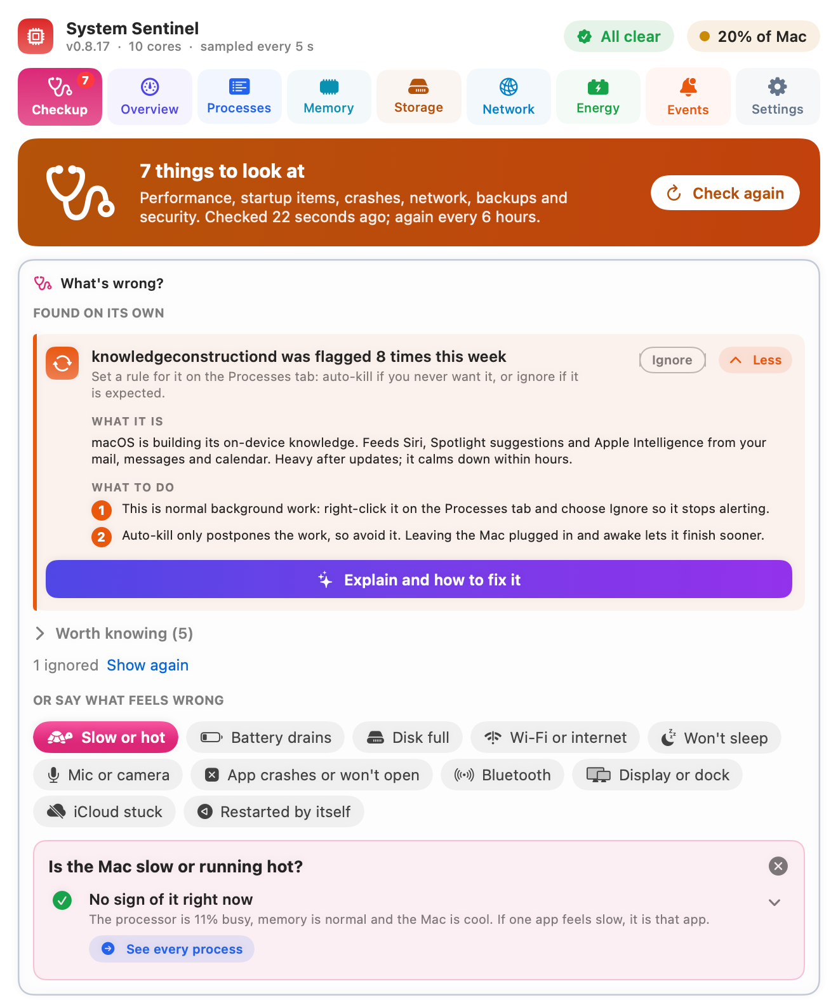

# System Sentinel user guide

[Back to README](../README.md) · [Process guide](processes.md) · **[Online guide with screenshots](https://cloudscale.consulting/system-sentinel/)** (Help, Cmd ?, in the app)

- [The basics: what the percentages mean](#the-basics-what-the-percentages-mean)
- [The menu bar icon](#the-menu-bar-icon)
- [Checkup](#checkup)
- [Overview](#overview)
- [Insights](#insights)
- [Processes](#processes)
- [Trends](#trends)
- [Memory](#memory)
- [Storage](#storage)
- [Network](#network)
- [Energy](#energy)
- [Optimise](#optimise)
- [Events](#events)
- [Rules](#rules)
- [Settings](#settings)
- [Resource alarms](#resource-alarms)
- [Notifications](#notifications)
- [Killing processes](#killing-processes)
- [Explain with ChatGPT](#explain-with-chatgpt)
- [Open in window](#open-in-window)
- [Share with a friend](#share-with-a-friend)
- [Files and privacy](#files-and-privacy)
- [Getting help and reporting a problem](#getting-help-and-reporting-a-problem)
- [Reset settings](#reset-settings)
- [Uninstall](#uninstall)
- [Troubleshooting](#troubleshooting)

---

## The basics: what the percentages mean

Every CPU figure is a **share of the whole Mac**: 100% means every core is flat out. On a
10-core Mac, one process keeping one core busy shows as 10%. Activity Monitor counts per
core instead (that same process shows 100% there, and a busy one can reach 1000%), so its
numbers are the app's numbers times the core count. The Processes footer says how many cores
your Mac has.

**Network speeds** are in Mbit/s, the unit speed tests and internet plans use (8 Mbit/s is
1 MB/s). Disk speeds and sizes stay in bytes (MB/s, GB).

**Averages** cover the time System Sentinel was running. If it was quit or the Mac was asleep,
those hours count as unknown, not idle, so an evening with the Mac closed doesn't pull the
average down.

**Sampling.** System Sentinel reads the process table every 5 seconds with `ps`, the same
source Activity Monitor uses. System Sentinel and the commands it runs for its checks (`ps`,
`top`, `nettop`, `ping`) average well under 1% of the Mac.
Those commands count as System Sentinel in every list and chart, so they are never flagged.
**About, Details, Its own CPU** shows the figure for the last minute, and background checks
wait while it is over its budget.

---

## The menu bar icon

Click the icon to open the panel. Its colour is the Mac's health at a glance:

| Icon | Meaning |
|---|---|
| Green | All clear: under 40% of the Mac busy over the last minute. |
| Amber | Busy (40 to 70%), or something worth a look. |
| Red | Over 70%, a process was flagged, or a serious problem. |
| A symbol in the chip | The worst risk right now: the chip, memory, disk, heat or battery. |
| A flashing red plug | The battery is about to run out. |
| A blue dot | An update is ready. Open About to install it. |

**⌃⌥⌘S** (Control-Option-Command-S) opens System Sentinel's window from any app. Use it
when the icon is out of sight: on a MacBook with a full menu bar, macOS hides icons behind
the notch without saying so.

**Settings > Menu bar** can add a readout beside the icon: the Mac's CPU load, the power
draw in watts, or the battery charge (with time left when unplugged).

Top right, **CPU 22%** is the whole Mac's CPU load right now (100% means every core busy),
and **GPU 9%** is how busy the graphics chip is. Each dot turns from green to amber to red as
the load rises.

Beside them, the status chip reads **All clear** or names what is wrong (**Memory under
pressure** or **Memory pressure critical**, CPU,
GPU, disk low, heat, battery). The menu bar icon takes the same colour, green, amber or red,
and the symbol of the worst problem. The GPU counts once the graphics chip averages 60%
over a minute (amber) or 90% (red), which a local AI model can do while the CPU sits idle. Click it to open the tab about the first problem: memory pressure
opens Memory, disk opens Storage, battery opens Energy.

---

## Checkup



The first tab, and the one the app opens on the first time. After that it reopens on the
tab you were last on.

- **What's wrong?** at the top. **Found on its own** lists what System Sentinel noticed
  without being asked: the Mac running hot, the processor or memory short, the battery
  draining fast, the disk nearly full, an app keeping the Mac awake, an app that keeps
  crashing, and the insights below. Each has **Fix it** and **Ignore** (or **Snooze a day**). **Worth knowing**
  holds findings that are not problems.
- **Or say what feels wrong:** eleven symptoms (Slow or hot, Battery drains, Disk full, Wi-Fi
  or internet, Won't sleep, Mic or camera, App crashes or won't open, Bluetooth, Display or
  dock, iCloud stuck, Restarted by itself). A dot means something was found there. Picking
  one opens a panel with what was found and the fixes.
- **Ignore** a finding about a particular app that is on purpose: it stays ignored until you
  click **Show again**. A passing state such as running hot has **Snooze a day** instead.
- **Pause alerts:** the bell at the top right pauses alert notifications for 1 hour, 4 hours
  or until tomorrow morning, for a meeting or a presentation. Monitoring carries on, and a
  low battery still warns. While paused it shows the time they come back.
- **The checks**, performance first and security last: System, Apps, Network, Backup,
  Security, each with fix buttons. Buttons with a lock ask for your admin password.
- **Quick fixes:** the everyday restarts (sound, Bluetooth, Wi-Fi, Finder, Dock, iCloud
  sync and more), each saying when you would need it.

---

## Overview


Overview has two pages, picked at the top: **Now** (below) and **[Trends](#trends)**.

The answer to "is my Mac busy, and why?" in one screen:

- **CPU panel.** A dial with the whole Mac's load, how many cores are busy, a thermal chip
  (Cool, Warm, Hot, throttling, or Overheating) and the watts the CPU is drawing. When the
  Mac is hot, macOS slows the CPU down, so the same work takes more of it. From 30% load it
  also names the two apps doing most of it, in their chart colours, with their share of the
  Mac ("claude 14%").
- **GPU panel.** The same for the graphics chip: a dial, its name and core count, its watts
  and the two apps using it most (5% or more each). Local AI models, video and games load the
  GPU rather than the CPU, so a quiet CPU dial can sit beside a full GPU one.
- **Power line.** Always shown on a Mac with a battery: **Charging** (green, what the charger
  delivers), **Using** (red, the whole Mac), and **Battery** (green and + while charging, red
  and − while draining). Then **No power**: on battery, how long until it runs out, to the
  nearest hour ("No power: 5 hrs", minutes under an hour; hover for the exact time and clock):
  green with more than 4 hours left, amber under 90 minutes, red under 30. While charging it
  shows **Full** instead, in blue ("Full: 4h 8m, 18:40"). Plugged in and barely charging, it
  shows **If unplugged**: how long the charge would last at the Mac's average use over the last
  hour. When the charge went down over the last hour even on the charger (it is too small for
  the load), it shows **No power** instead. Both are worked out every 10 minutes, and at once
  when you plug in or unplug, so a busy or quiet minute does not make them jump. Battery
  (red and −) is the reading right now.
- **1 min / 15 min / 1 hour** on each panel. Use averaged over each period. A high 1 minute
  figure with a low 1 hour figure is a spike; all three high means it has been busy for a while.
- **Right now.** A donut of the five apps using the most CPU at this moment, plus
  everything else. The number in the middle is how busy the whole Mac is.
- **Last hour, by app.** A stacked chart of the top apps over the last hour, as a share of
  the whole Mac. Colours stay with each app across every chart in the app, so Chrome is
  always the same colour.
- **Click either chart** to open a larger, live version in its own window. The larger
  Right now chart lists more apps; the larger Last hour chart shows the
  values at any moment when you hover over it.
- **Cores.** The load on each core over the last 5 seconds. On Apple silicon the
  efficiency cores (E) come first and the performance cores (P) after. macOS runs
  background work on E cores; busy P cores mean heavy foreground work, and that is where
  most of the power goes.
- **Memory.** Memory pressure as macOS judges it (Normal, Under pressure or Critical), memory
  used, compressed and swapped to disk. Pressure matters, not how full memory looks.
- **Graphics (GPU).** How busy the graphics chip is now and on average over the last hour,
  a chart of that hour, the graphics memory in use, and the apps using the chip right now
  with each one's share. Games, video export, 3D and AI models use it most. On Apple silicon
  graphics memory is part of the Mac's memory, not separate.
  **power now** is the watts the graphics chip draws (point at it for the hour's average and
  its share of the whole Mac's draw). **Save power** lists what would cut it right now, with
  buttons: optimise the screen, close a browser tab that is drawing, unload a local AI model
  (or use a smaller, 4-bit one), quit an app using the chip in the background, or turn on
  Low Power Mode on battery, which lowers the graphics clock.
- **Things to look at.** When Checkup has found something, a line at the top of the
  Overview says how many and names the first. Click it to go to Checkup.

---

## Insights

Insights are short findings worked out from what System Sentinel has seen. They are listed
on Checkup: the ones worth acting on under **Found on its own**, the rest under **Worth
knowing**. The most urgent ones come first. Each has a coloured edge: red is urgent, amber is worth a look, blue is
for your information and green means all is well.

Click **More** on an insight to open it:

- **What is happening:** the longer explanation.
- **The processes involved:** each one with its CPU, what it is, and **started by**: the
  app that launched it. That is how you find which app keeps taking screenshots, for
  example. Each process has its own Explain, bring-to-front and Kill buttons.
- **What to do:** numbered steps.
- **Explain and how to fix it:** opens ChatGPT with the whole insight as a prompt.

Many insights also carry **fix buttons**, visible without opening them. Red ones act:
**Quit** (the app quits normally and can save), **Stop** (kills the processes; stopping
several asks first, except `caffeinate`), **Turn on Low Power Mode** (asks for your
password). Blue ones open the right page of System Settings.

A minute after you quit or kill something, a banner says what it changed, for example
"power 14.0 W → 6.0 W, CPU 30% of the Mac → 8.0% of the Mac, about 4h 0m more battery". The
Events tab keeps the recent results.

### Insights you may see

| Insight | When it appears | What it tells you |
|---|---|---|
| **Overheating / hot / running warm** | macOS reports a raised thermal state | macOS is slowing the CPU to cool down. Close the heaviest apps and give the Mac airflow. |
| **Low Power Mode is on** | Low Power Mode is enabled | The CPU runs slower, so everything reads higher. |
| **The Mac is N% busy** | 70% or more of the whole Mac is busy | The Mac is close to flat out. |
| **Busier than usual** | Load is at least twice the last hour's average | Something new has started. |
| **All quiet** | Under 10% of the Mac is in use | Nothing needs attention. |
| **X has averaged N% for 15 minutes** | A process has stayed at 50% or more for the last 15 minutes | Sustained use, not a spike: a candidate for a rule. |
| **X (N%): what it is** | A macOS service you may not recognise is at 20% or more | What it does and whether to wait or act. See the [process guide](processes.md). |
| **Screen capture is costing N% of the Mac** | WindowServer plus the capture services use 10% of the Mac or more (under that it is an info row ending "fine", not in Checkup) | Every screenshot, recording, screen share or AI agent screenshot makes WindowServer draw a full frame. The capture services are listed one by one, with how to stop each. |
| **WindowServer is at N%** | WindowServer is busy with no capture running | Usually displays: scaled resolutions, 120 Hz, many windows, transparency. |
| **N copies of X use N% together** | Three or more processes of one app add up to 15% or more | Easy to miss in a list, such as Chrome tabs or idle terminal sessions. |
| **X used N% of all CPU time today** | After 30 minutes of recording | The day's heaviest app. |
| **macOS itself vs your apps** | After 30 minutes of recording | How much CPU went to background system work compared with apps you run. |
| **Busiest hour** | After an hour of recording | When in the day the Mac worked hardest. |
| **X was flagged N times this week** | An app was flagged three or more times in 7 days | Set a rule instead of dismissing the alert again. |
| **X costs about N minutes of battery an hour** | On battery, one app is 20% or more of all energy use | Its share of the power draw, and how much longer the battery would last without it. |
| **N% left: Low Power Mode would stretch it** | On battery at 30% or less, Low Power Mode off | How to turn it on. |
| **Time Machine / Spotlight / Photos analysis running on battery** | A deferrable macOS job is at 20% or more on battery | Plug in and it finishes sooner at no battery cost. |
| **N things are keeping your Mac awake** | Something has held a sleep assertion for over an hour | Who is holding it (for `caffeinate`, the tool it works for) and a Kill button for each. |
| **X wakes the CPU N times a second** | An app causes 150 or more idle wakeups a second | Constant wakeups cost battery even at low CPU. |
| **macOS says: Check Battery** / **Battery holds N%** | macOS reports a battery condition, or capacity is under 80% | What it means and what to do. |
| **The Mac is N times busier than usual this hour** | The last hour is at least twice the 7 day hourly average | Something unusual is running. |
| **Memory is tight: N GB in swap** | macOS reports memory pressure | The apps holding the most memory, and a Quit button for the largest. |
| **X is working N times harder than usual** (or **is busy, and it is normally idle**) | An app has averaged 30% or more for 15 minutes, at least 4 times its own hourly average over the last week | Measured against the app's own history, so a normally light app working hard stands out below the alert threshold. |
| **X is using the graphics chip in the background** (or **is using N% of the graphics chip**) | An app has averaged 25% of the graphics chip or more for 5 minutes while another app is in front, or 60% while it is in front | Says what to do for the kind of app: find the tab in a browser, stop a local AI model, lower a game's settings. Quit, and Low Power Mode on battery. When the screen itself is the cost (WindowServer), it offers Optimise screen and Displays settings instead. |
| **Lost N% an hour while asleep** / **Woke N times while asleep** | Sleeping on battery lost 1.5% an hour or more, or 40 or more dark wakes in 24 hours | What wakes it and how to stop it. |
| **Plugged in at 100% N% of the time** | Over the last week, 10 or more hours on the charger, mostly full | Sitting full wears the battery; set a charge limit. |
| **X survived a kill** | A kill failed in the last 24 hours | The process ignored the polite stop signal; only a force kill would stop it. |

### Example: WindowServer and screen capture

WindowServer draws everything on your displays. Normally it redraws only what changed,
which is cheap. A screen capture makes it produce a whole new frame at full Retina
resolution every time, even when nothing moved. Something that captures several times a
second keeps WindowServer busy all the time:

- **SkyComputerUseService, Codex Computer Use:** AI agents that screenshot your screen so
  the AI can see it. They can keep capturing while idle; a few percent of the Mac is normal.
  Quit ChatGPT with Cmd-Q (closing the window is not enough) to stop it. Settings, **Stop
  ChatGPT's screen helper when idle** (off by default; turn it on there) stops it after 15 minutes without ChatGPT
  in front; ChatGPT starts it again when you use it.
- **replayd:** macOS screen recording. Busy while any app records, streams or shares the screen.
- **screencapture:** the screenshot command. If it keeps coming back, check **started by**
  to see which app runs it in a loop.
- **screencaptureui:** the screenshot toolbar and recording overlay (Cmd-Shift-5).

To fix it: stop the agent, recording or screen share. Then review **System Settings >
Privacy & Security > Screen & System Audio Recording** and switch off apps that shouldn't
be capturing.

---

## Processes


The 30 busiest processes, refreshed every 5 seconds.

- **Filter** by name. **Sort** with the **Sort** menu, or click a column title: **Process**
  (name, A to Z), **CPU** (now), the average (click again to switch between 15 minutes,
  1 hour and 6 hours), **memory** or **GPU**. Sorting by an average ranks every process,
  including ones idle right now.
- **pid and uptime:** "up 13d 0h" means the process has been running for 13 days. A busy
  process with a long uptime is a classic stuck process.
- **What it is waiting on**, after the uptime, for a process doing something: **Busy on
  CPU**, **Waiting on disk** (heavy reads or writes, or stuck in the kernel on disk),
  **Waiting on memory** (stuck paging while memory is tight) or **Waiting on network**.
  Nothing is shown for an idle process.
- **Badges** are small icons beside the name; point at one to read it: a lock (runs as
  root, needs your password to kill), a flame (over your threshold, and for how long), a
  warning (flagged), a tortoise (background priority), and its rule if it has one. A
  flagged process, or one over your threshold (flame), gets the whole row in red.
- **15 min trend:** a sparkline of its CPU.
- **CPU / 15 min / memory / GPU:** the CPU now with a heat bar, the 15 minute average,
  memory used, and its share of the graphics chip over the last 5 seconds ("–" for none).
- **⋯ Actions** holds everything you can do to it. It shows a wand instead when there is a
  specific fix for that process.
  - **What is this?** opens a window with its averages, a 1 hour chart and its full path.
    If the [process guide](processes.md) knows it, it also says what it is and gives a
    verdict: *Normal: it settles on its own*, *Safe to stop*, *Do not kill* or *Something
    you started*.
  - **Explain with ChatGPT.**
  - **Optimise…** lowers its priority, restarts it, or applies a fix for that process.
    For WindowServer, **Optimise the screen…** opens settings that make it draw less.
  - **Kill**, **Force kill (kill -9)…**, or **sudo kill…** for a core macOS process; see
    [Killing processes](#killing-processes). While a kill runs a spinner replaces the
    menu, and a banner over the page then says whether it worked.
  - **More** has the right-click items below.
- **restarted** means the process was killed a moment ago and launched again under this pid.

**Right-click** a row for more:

- **Rule:** Alert me (the default), Auto-kill, Ignore for 1 hour, Always ignore.
- **For apps:** Bring to front, Quit gracefully (asks the app to quit, so it can save your work).
- Reveal in Finder, Copy pid, Copy sudo kill command, Open Activity Monitor.

Chrome runs each site in its own process, shown as **Chrome tab (renderer N)**. Chrome
doesn't reveal which tab a renderer serves; use Chrome's own Task Manager (Window > Task
Manager) to match them up.

---

## Trends


The second page of Overview. What used the CPU over time, kept across restarts.

- **30 min / 3 hours / 6 hours / 24 hours / 7 days.** Bars of 1 minute, 5 minutes,
  10 minutes, 1 hour and 6 hours. Up to 6 hours comes from a one-minute record, longer from
  the hourly one.
- **Group by app.** On: helpers count towards their app, so all Chrome tabs count as
  Chrome. Off: each executable on its own line.
- **Tiles:** how long was recorded, total CPU time used, the average load and the top app.
- **CPU by hour:** stacked bars as a share of the whole Mac. The top six apps have their
  own colours and the rest are grey. Hours with no recording are left blank.
  **Hide everything else** drops the grey bars, so the named apps fill the chart.
- **Heaviest users:** share of all CPU time (the bar), the average over the recorded time,
  the peak hour and when it was, and total CPU time. Hover a row to see what the process is.

**CPU time** is core-time: one core busy for one minute is one minute of CPU time, so an
app can use more CPU time than the time that passed.

---

## Memory

Memory pressure is what matters, not how full memory looks: macOS fills spare memory with
caches on purpose. The tab shows:

- **Memory:** pressure (Normal, Under pressure or Critical), used, compressed and swap.
- **Memory and swap over time:** the last hours to 7 days (14 and 28 with longer history).
- **Memory by app:** each app's whole footprint, helpers included, with Quit and a **Rule**
  menu to quit it by itself over 2, 4, 8 or 16 GB (see [Rules](#rules)).
  **What is running?** opens an app with several processes by what they actually run, such
  as the scripts and servers behind "Python" or "node", each with the folder it started in,
  its memory and its own Stop, so you can stop one without quitting the rest.
- **Free up memory:** what would free the most, with buttons. For the app holding the most
  swap there is also **Restart**: it quits the app the normal way (as ⌘Q would), opens it
  again and says how much swap came back. macOS has no way to flush swap, so this is the only
  way to free it without restarting the Mac. The same button is on the "holds the most swap"
  insight.
- **How Mac memory works:** compression, swap and why free memory is wasted memory.

---

## Storage

How full the disk is, what is growing and what you can safely delete.

- **The header:** free space, what macOS frees by itself when needed (purgeable), growth a
  day over the last week, and when the disk would be full at that pace. Green says **Plenty
  of space**, or **Enough space today, but filling up** when it would be full within 60 days.
- **Disk use over time** and **What grew** (24 hours, 7 or 30 days): the folders that grew.
- **Quick cleanups:** the Trash, Downloads, caches, old simulators and installers, each with
  its size and a button. Things go to the Trash where they can, so you can put them back.
- **Where the space is**, **Largest files**, **Packages you can delete**, **Videos**,
  **Photo folders to archive** and **Known folders** (Xcode, Docker, npm, Cargo and others).

Without **Full Disk Access** macOS hides Desktop, Documents, Downloads, the Trash, Mail,
Messages and other apps' data, so those are left out. Grant it once in System Settings,
Privacy & Security, Full Disk Access to measure everything and stop macOS asking about each
folder.

---

## Network

Is the connection healthy, and which app is using it.

- **The header:** **Connection is healthy**, **Working, N things to check**, or
  **Connection problem**, with Wi-Fi signal and band, any VPN or zero trust client (Zscaler,
  Netskope, GlobalProtect and others) and the speed now.
- **Speed, last hour**, **Connection** (interface, router, address, DNS, VPN or proxy) and
  **Quality:** delay, loss and jitter to the router and the internet, tested every 3 minutes,
  resent packets and the largest packet that fits (MTU), inside a tunnel too.
- **DNS doctor** (every 10 minutes): whether names resolve, how fast, a sign-in page in the
  way (hotel and airport Wi-Fi), and the **Work name to check** from Settings, which only
  resolves on the office network or VPN. **DNS map** shows where a name really goes.
- **Route test (mtr):** for 1 minute up to an hour, loss, delay and jitter at every hop, a
  chart of when it happened and a report to send your provider.
- **Speed test:** macOS's own `networkQuality`, about 20 seconds, against Apple's servers.
  It warns first on a phone hotspot or metered connection.
- **HTTPS inspection:** whether a company proxy is re-signing secure connections, and the
  lines that make developer tools (git, npm, pip, curl) trust its certificate.
- **Top talkers**, **Where the data goes** and **Connections that failed** over the last
  hour, by app. A tunnel such as Zscaler carries every other app's traffic, so it is shown
  with a "carries all traffic" pill instead of being blamed for it.

---

## Energy


What the Mac draws and what is costing battery:

- **Battery.** Charge, time left (macOS's estimate, or the charge left divided by the
  current draw), charging state, charger watts, temperature and the whole Mac's power
  draw in watts, with the same Charging / Using / Battery chips as the Overview. A
  charger too small for the load shows as **Losing charge on power**, with the time to empty.
  On a Mac without a battery this is replaced by a note.
- **Power draw.** Watts over the last hour, 6 or 24 hours, or 7 days, coloured by battery
  or mains power, with the average, peak, time on battery and how many percent an hour the
  battery dropped. A MacBook idles at about 3 to 8 W with the screen on.
- **Power by part.** Watts for the processor, the graphics chip, the Neural Engine and
  memory, measured by the chip itself every 5 seconds without a password, the display engine,
  and the rest of the Mac (screen backlight, Wi-Fi, SSD, charging). Apple silicon only.
- **Energy by app.** Activity Monitor's Energy Impact (CPU plus the cost of waking the
  chip, graphics and disk) and idle wakeups a second, refreshed every 30 seconds.
  Each app's estimated watts is its share of Energy Impact applied to the draw above about
  2.5 W (screen and idle chip); on battery it also shows the minutes of each hour it
  costs. **24 hours** and **7 days** rank average Energy Impact over that period.
- **Keeping your Mac awake.** Every process holding a sleep assertion, how long it has
  held it, and for `caffeinate` the tool it works for ("for claude (pid 61739)").
  Killing `caffeinate` lets the Mac sleep; the tool carries on.
- **Battery health.** Capacity against new, charge cycles against the design count, and
  macOS's verdict (Normal, Check Battery, Service Recommended), with advice.
- **Sleep, last 24 hours.** From macOS's power log: time asleep, dark wakes (the Mac
  waking with the screen off) and what caused them, and charge lost an hour while asleep
  on battery. About 1% an hour or less is healthy.
- **Graphics and displays.** How busy the graphics chip is, screen brightness, each
  display with its resolution and refresh rate, and tips (brightness is often the biggest
  single draw; external and high refresh displays cost graphics work).
- **Network and disk.** Download, upload and disk traffic by app, every 30 seconds. Disk
  for processes run by the system is not visible to apps.
- **Battery wear and charging.** Health logged once a day, charted with the 80% line, a
  projected date for reaching 80% after two weeks of readings, cycles a week, and
  charging habits: time on the charger and how much of it at 100%.
- **Chrome tabs.** On the Chrome row of Energy by app, **Tabs** lists every open tab with
  likely energy users first (video, calls, live apps), each with **Show** and **Close**.
  Chrome does not say which tab uses what, outside its own Task Manager.
- **Today in brief.** The day in a few sentences: average load, heaviest apps, busiest
  hour, time on battery, average draw and drain, and sleep blockers.

---

## Optimise

**Optimise** (from a WindowServer or graphics insight, or a process's Actions menu) lists
what makes the Mac draw less: **Draw less** (reduce transparency and motion, Stage
Manager, desktop widgets, window and Dock animations and more, each with Apply and Undo), **Displays**, **Windows on screen**, and **Menu bar
icons hidden behind the notch**. Every change records what it was, so Undo puts it back.
For one process, **Optimise…** lowers its priority (it then waits for the efficiency cores),
restarts it, or applies a fix known for it.

---

## Events


**Your week** at the top: core-hours used, hours watched, time on battery, average power
draw, the five heaviest apps and the busiest day.

Everything System Sentinel did, or decided not to do:

| Event | Meaning |
|---|---|
| **Flagged** | The process stayed over your threshold for the whole window. |
| **Killed** | You killed it. |
| **Auto-killed** | A rule killed it. |
| **Kill failed** | It was still running after the kill: it ignored the polite signal, or the password prompt was cancelled. |
| **Held back** | A rule said auto-kill, but it had already been killed 3 times in the last hour, so you were alerted instead. |

The tiles count the last 7 days, the chart shows each day, and the log lists every event
with its time and CPU.

**Not responding** lists apps that froze (the spinning wheel) for more than 2 seconds, and
System Sentinel's own window if it froze for more than half a second, each with the likely
reason taken at the moment it froze: the app busy on CPU or waiting on disk, memory or
network, the whole Mac busy, memory pressure or swap, or heat. "No sign of CPU, memory or
disk trouble" means the app itself was stuck. **Copy all** puts the list on the clipboard
for a bug report.

**What stopping things changed** lists the measured result of recent quits and kills.
**Share a report** saves the week, today, battery, sleep and memory as Markdown or PDF.

---

## Rules


The second page of Settings. Every app you have set a rule for, and a button to remove each one. Below them,
**Starts by itself** lists every launch agent and daemon (from `~/Library/LaunchAgents`,
`/Library/LaunchAgents` and `/Library/LaunchDaemons`): whether it runs at login, stays
running or runs on a timer, whether it is running now and its CPU, heaviest first.
The bin stops one and moves its file to the Trash (Put Back undoes it); ones installed for
every user ask for your password. **Login Items** opens System Settings, where you can
switch them off instead.

Rules are keyed by the
program's path, so they survive restarts and new process IDs. All Chrome tabs share one
path, so a rule for one tab applies to every tab.

| Rule | What happens when the process is flagged |
|---|---|
| **Alert** (default) | A notification; you decide. |
| **Ignore for 1 hour / always** | Nothing. |
| **Auto-kill** | It is killed and you are told. Not offered for root or core macOS processes. At most 3 kills an hour per app; after that you are alerted instead. |
| **Auto-kill on battery** | Auto-kill while on battery; alert when plugged in. |
| **Auto-kill when battery under 30%** | Auto-kill only on battery below 30%; alert otherwise. |
| **Ignore during work hours (9:00–17:00) / overnight (22:00–07:00)** | Nothing during those hours; alert outside them. For a build server that is expected to be busy at work, or a backup at night. |

**Memory rules** are set from the **Rule** menu on each app under Memory by app: quit it by
itself when it holds over 2, 4, 8 or 16 GB. It must stay over the limit for 5 minutes and not
be the app in front; it is asked to quit politely (as with Cmd-Q, so a VM host such as Rancher
Desktop shuts its virtual machine down cleanly), at most once every 30 minutes, and you get a
notification. For a VM, the limit counts the app and its virtual machine together. They are
listed under Rules with a Remove button.

---

## Settings


Settings has two pages, picked at the top: **Settings** (below) and **[Rules](#rules)**.

- **Over N% of the Mac for N minutes without a break** decides when a process is flagged.
  The default is 80% of one core (8% of a 10-core Mac) for 2 minutes. Builds and other short bursts never count;
  only a process that stays over the line the whole time does.
- **Tell me when an app stops responding** (on by default): a notification when an app has
  shown the spinning wheel for 10 seconds, with the likely reason.
- **Launch System Sentinel at login.**
- **Weekly report notification** on Monday morning (on by default).
- **Menu bar:** nothing, CPU load, power draw or battery beside the icon.
- **History:** keep 7 (default), 14 or 28 days of CPU, memory, energy, power and DNS
  readings, about 11, 18 or 31 MB on disk. The longer settings add 14 and 28 day ranges to
  the CPU, Memory, Power draw and Energy charts. Memory older than a week keeps its list of
  the largest apps once an hour, which keeps the file small. CPU minute by minute is always
  kept for 6 hours. A shorter setting deletes the older readings within a few minutes.
- **Heat and power alerts** (on by default): a pop-up when macOS reports the Mac is hot,
  or when the power draw stays over your level (10 to 60 W, default 25 W) for your chosen
  time (1 to 30 minutes, default 3). A MacBook idles at 3 to 8 W; 20 to 30 W is heavy
  work. The alert names the likely culprit with Kill and Ignore buttons, at most once
  every 30 minutes (getting hotter still breaks through).
- **Low battery alerts** (always on): a notification at 20 minutes of battery left and
  again at 5, with the time it runs out. They also fire when plugged into a charger that
  cannot keep up. Once each per drain; plugging in and charging starts over.
- **Sleep blockers:** notify when something keeps the Mac awake longer than N hours
  (default 2). Once per hold; several at once arrive as one notification.
- **Resource alarms:** see [below](#resource-alarms).
- **Network:** the work name the DNS doctor checks, and phone hotspot alerts.
- **Updates:** automatic checks (at launch and every 6 hours) and Reinstall.
- **Permissions:** what System Sentinel may do, and what stops working without each one.
- **Diagnostics:** background jobs, recent errors, **Copy diagnostics**, **Report a
  problem**, **Export…** and **Reset all settings…**.

Changes apply when you click **Save**; **Revert** throws them away. Unsaved changes are kept
if you go to another tab and come back, until you Save or Revert; a pencil on the Settings
tab shows they are waiting.

### Export

**Export…** (Settings, Diagnostics; also on Events and Processes) saves your data as CSV, for
a spreadsheet, or JSON:

- **History:** CPU, memory, swap, power, battery, disk and network readings over time, one
  reading per row (time, metric, value, unit).
- **Events:** flags, kills, crashes and alerts.
- **Processes now:** every process with CPU, 15-minute average, memory and GPU.
- **Full report** (JSON): all of the above plus the Mac, macOS and app version, for IT.

Times are in UTC, decimals use a dot, and CPU is a share of the whole Mac.

---

## Resource alarms

A notification when the whole Mac crosses a line you set, once, then not again until it is
back under the line and at least an hour has passed. All on by default:

| Alarm | Default |
|---|---|
| Whole Mac busy | over 85% of all cores for 10 minutes |
| Swap used | over 8 GB |
| Memory pressure | Under pressure or Critical for 5 minutes |
| Disk space low | under 20 GB free |

Per-app CPU alerts are set at the top of Settings; heat, power and sleep alerts in the cards
above the alarms.

---

## Notifications

When a process is flagged you get a notification with:

- **Kill**: kill it now.
- **Ignore for 1 hour**: no more alerts for it for an hour.
- **Always ignore**: never alert for this app again (removable on Settings, then Rules).
- **Always auto-kill**: kill it now and every time from now on.

Heat and power alerts carry the same buttons for the likely culprit. If the culprit has
an Ignore rule, the alert still comes but does not name it.

Each process alerts once per episode, not every 5 seconds. If notifications don't appear,
allow them in **System Settings > Notifications > System Sentinel**.

---

## Killing processes

These are in each row's **⋯ Actions** menu.

| Action | For | What happens |
|---|---|---|
| **Kill** | Your own processes | A polite stop signal (SIGTERM), and a force kill (SIGKILL) 5 seconds later if it is still running. |
| **Kill (asks for your password)** | Root processes, e.g. PerfPowerServices | macOS asks for your admin password, then sends SIGTERM. Daemons like this are restarted by launchd, usually without the problem. |
| **sudo kill…** | Core macOS processes: WindowServer, kernel_task, launchd, loginwindow, Finder, Dock, coreaudiod and others | A warning of what will happen, then four choices: **Open sudo shell** (Terminal with `sudo kill -TERM <pid>` typed in), **Kill with password**, **Copy command**, or **Cancel**. pid 0, pid 1 and System Sentinel itself are always refused. |

Things to know:

- **Killing WindowServer logs you out** and closes every app. **kernel_task** is macOS
  cooling the Mac and can't be killed usefully. The [process guide](processes.md) gives a
  verdict for each common process.
- **Force kill.** Some processes ignore the polite signal, and the kill then shows as
  **Kill failed**. Checkup's "survived a kill" finding lists the process with a
  **Force kill** button, and every process's Actions menu offers **Force kill (kill -9)…**.
  It confirms first, because the process can't save or clean up. Root and macOS processes
  ask for your password, or you can open a Terminal with `sudo kill -9 <pid>` typed in.
- **Relaunched at once?** Some programs come straight back under a new pid, launched by
  macOS (launchd) or by the app that owns them. The banner says so and names who restarted
  it, and the row shows **restarted**. Killing it again won't help: stop whatever launches it.
- **Terminal kills** (Open sudo shell) are watched for a minute. When the process exits,
  the banner says it stopped.
- **Quit gracefully** (right-click an app) is the gentle option for apps: it asks the app to
  quit, so it can save first.
- Killing a **Chrome tab** renderer shows "Aw, Snap!" in the tabs it served. Reload them to
  bring them back.
- The first time you use the Terminal option, macOS asks whether System Sentinel may control
  Terminal. Allow it, or use **Copy sudo kill command** and paste it yourself.

---

## Explain with ChatGPT

Every ✨ button opens `chatgpt.com` in your browser with a prompt filled in. For a process,
the prompt contains:

- the process name, path, whether it runs as root, its CPU now and averaged over 1 minute,
  15 minutes and 1 hour, its memory and when it started;
- what the process guide knows about it;
- your Mac model, number of cores, macOS version, thermal state, displays (resolution and
  refresh rate) and the other busy processes.

An insight's prompt contains the insight, each process involved and who started it, and
the same Mac details. It asks what is going on, the likely causes on your machine, step by
step fixes, and whether killing is safe.

The prompt is part of the page address, so treat it as shared with OpenAI once the page
opens.

---

## Open in window

The menu bar panel stays pinned under the icon, at a fixed size, and closes when you click
elsewhere. Click **Open in window** at the bottom to open the same screens in a normal window.
You can drag it, resize it to any size (the screens fill it) and minimise it, and it stays open
while you work. It remembers its position and size. **⌃⌥⌘S** opens it from any
app.

---

## Share with a friend

Click **Share with a friend** in About, or **Share** at the bottom of the main window. The
Mac's share menu opens: Messages, Mail, WhatsApp, AirDrop, Notes and so on. The message says
what the app does and how to install it: open Terminal and paste one line,

```bash
curl -fsSL https://raw.githubusercontent.com/andrewbakercloudscale/system-sentinel/main/install.sh | bash
```

which downloads the latest version, puts it in Applications and opens it.

---

## Files and privacy

History and rules are kept in `~/Library/Application Support/SystemSentinel/` (About,
**Open the data folder**):

| File | Contents |
|---|---|
| `policies.json` | Your CPU rules |
| `memory-rules.json` | Your memory rules |
| `history.jsonl` | Events (flagged, killed, and so on) |
| `usage-24h.json` | Hourly CPU time per program (7 to 28 days, per Settings, History) |
| `usage-6h.json` | CPU time per program per minute for the last 6 hours |
| `power-7d.json` | Power draw and battery level per minute |
| `energy-7d.json` | Hourly Energy Impact per program |
| `memory-7d.json` | Memory, swap and pressure, and the largest apps |
| `storage-90d.json`, `storage-scan.json`, `storage-tree.json` | Disk use over time and the last scan |
| `dns-24h.json`, `speed-test.json` | Network checks and the last speed test |
| `battery-health.json` | One battery reading a day, kept indefinitely |
| `tweaks-backup.json` | What each Optimise change replaced, so Undo can put it back |
| `errors.log` | Background failures, for Diagnostics |

Settings are kept by macOS in its preferences, under `consulting.cloudscale.systemsentinel`.

**What leaves the Mac.** Nothing about you, your files or your apps is uploaded, and there is
no tracking. The checks themselves have to reach the internet:

- a ping (or a TCP handshake where pings are blocked) to 1.1.1.1 every 3 minutes;
- a lookup of www.apple.com and a load of captive.apple.com every 10 minutes (DNS doctor);
- the certificates of github.com, registry.npmjs.org and pypi.org every 30 minutes (HTTPS
  inspection);
- GitHub, for update checks at launch and every 6 hours (Settings, Updates turns them off);
- only when you start them: the speed test (Apple's servers), the route test (1.1.1.1 or the
  host you pick) and the DNS map (Cloudflare and Google DNS over HTTPS, and ip.zscaler.com);
- ✨ Explain, which opens ChatGPT with its prompt in the page address, so OpenAI receives it.

---

## Getting help and reporting a problem

- **Help** (Cmd ?) at the bottom of the panel opens the
  [online guide](https://cloudscale.consulting/system-sentinel/). Right click it for the
  **Welcome tour**: the three step welcome shown on first launch (what it watches, Notifications
  and Full Disk Access, the ⌃⌥⌘S shortcut). It is also in About.
- **Report a problem**, in About and in Settings, Diagnostics, puts the diagnostics on the
  clipboard and opens a new GitHub issue with your version and Mac filled in. Paste the
  diagnostics into it and say what happened.
- After a crash, a red banner says so the next time it opens, with **Show report**.

---

## Reset settings

**Settings, Diagnostics, Reset all settings…** asks first, then:

- **Reset settings** clears every setting, your CPU and memory rules, ignored findings and
  lowered priorities, keeps your history, and reopens the app;
- **Reset and delete history** also deletes the history, so every chart starts empty.

Launch at login and the permissions you gave are left as they are.

---

## Uninstall

1. Click **Quit** at the bottom of the panel.
2. Delete the app: drag `/Applications/System Sentinel.app` to the Trash.
3. Delete its data and settings in Terminal:
   ```bash
   rm -rf ~/Library/Application\ Support/SystemSentinel
   defaults delete consulting.cloudscale.systemsentinel
   ```
4. In System Settings, remove it from General, Login Items, and from Privacy & Security
   (Full Disk Access, Automation) if you allowed those.

---

## Troubleshooting

**The menu bar icon is missing.** The menu bar may be full: quit a few menu bar apps or
hold Cmd and drag icons around. Press **⌃⌥⌘S** to open the window meanwhile. Check it's running with `pgrep -l SystemSentinel`.

**Trends (on Overview) is empty or says "0 min recorded".** It fills in while System Sentinel runs. The
last-hour chart needs a few minutes and the daily insights need 30 minutes.

**Kill on a root process does nothing.** The password prompt may have been cancelled. The
event shows as **Kill failed**.

**"Kill failed: still running after SIGTERM as admin".** The process ignored the polite
signal. Core macOS processes often do. See [Killing processes](#killing-processes).

**The sudo kill button doesn't open Terminal, or the error mentions -1743.** System Sentinel isn't
allowed to control Terminal. Allow it in **System Settings > Privacy & Security >
Automation > System Sentinel > Terminal**.

**macOS says the app is damaged or can't be opened (downloaded build).** Run
`xattr -dr com.apple.quarantine "/Applications/System Sentinel.app"`, or try to open it once, then click **Open Anyway** in **System Settings > Privacy & Security**. The build isn't notarised by Apple, so this is you choosing to trust it; the source is public if you want to check it first. The command removes only the quarantine flag macOS adds to downloads.

**A process shows over 100%.** That's normal: 100% is one core. See
[the basics](#the-basics-what-the-percentages-mean).
